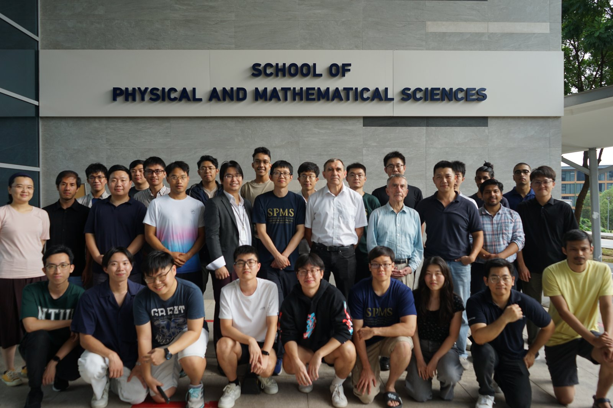

Climate change has become a main global challenge with countries committed to achieving carbon-neutrality by 2050. Nuclear fusion, a safe and potentially unlimited energy source, could provide the ultimate energy solution to our kind. 

NTU has opened a new research area in theoretical and computational fusion plasma physics.
 At NTU, we endeavour to combine the power of traditional physics-based models, high-performance computer simulations and modern machine learning technologies to accelerate the realisation of fusion energy. 

The group is located in Division of Physics and Applied Physics, School of Physical and Mathematical Sciences, Nanyang Technological University.

Please feel free to reach out to one of [our faculty members](/people/).

<!-- 

 -->
